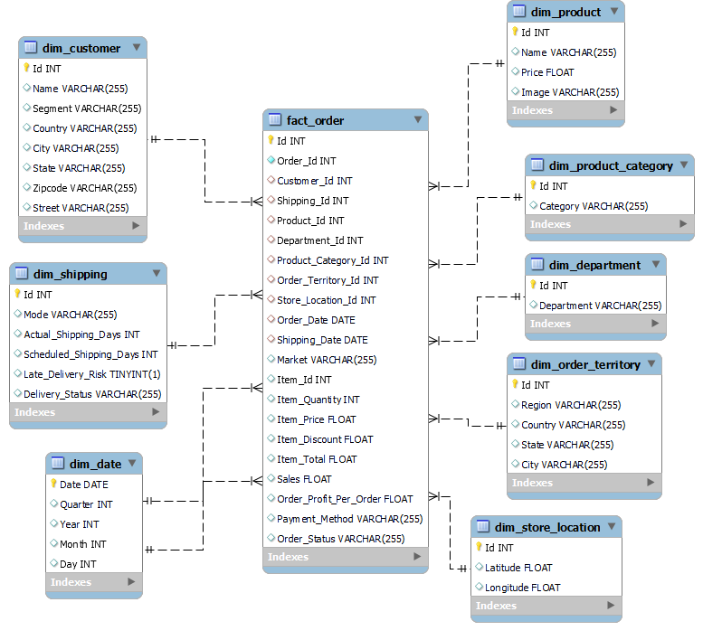

# Dataco Smart Supply Chain Analytics, ETL with KNIME and Dashboard via Power BI

## Project Overview
This project builds an end-to-end analytics pipeline on the DataCo Smart Supply Chain dataset. Raw order data is cleaned and transformed with KNIME, loaded into a MySQL star schema, and visualized in an interactive Power BI dashboard that helps stakeholders monitor sales, order fulfillment, payment behavior, shipping performance, and customer retention.

## ETL with KNIME

### Data Source
The dataset was obtained from Kaggle: [DataCo Smart Supply Chain for Big Data Analysis](https://www.kaggle.com/datasets/shashwatwork/dataco-smart-supply-chain-for-big-data-analysis).

### Dimension Tables
Each dimension table has its own workflow branch following the same pattern: a CSV Reader loads the raw file, Column Filter keeps only the relevant columns, Duplicate Row Filter keeps unique records, Math Formula generates a surrogate key, and the result is renamed, reordered, and written to MySQL with a DB Writer. A MySQL Connector and DB SQL Executor run SQL statements on the target table before each load.

**Additional Cleaning for `dim_customer`:** First and last names were combined into a single `Name` column, `EE. UU.` was replaced with `United States`, and invalid state values were transformed using Rule Engine.

### Date Dimension
`dim_date` is generated rather than extracted. The minimum and maximum dates across order date and shipping date are found with GroupBy, then Date&Time Range Creator generates every date in between, and Date&Time Part Extractor derives the date attributes.

### Fact Table
`fact_order` is built by re-reading the raw data and joining it with each loaded dimension table to retrieve the surrogate keys. After removing duplicates, a surrogate key is generated, date columns are converted to date type, and the table is loaded into MySQL after all dimension tables.

## Data Modeling

The data is modeled as a star schema in MySQL with one fact table and eight dimension tables: `dim_customer`, `dim_product`, `dim_product_category`, `dim_department`, `dim_shipping`, `dim_order_territory`, `dim_store_location`, and `dim_date`.

**Grain:** Each row in `fact_order` represents one order item. `Order_Id` is kept as a regular column so items can be grouped into orders.

**Role-Playing Dimension:** `dim_date` is reused for both order date and shipping date.

**Store Location:** Latitude and longitude are modeled as store location, following the dataset's data dictionary.

## BI Dashboard

The Business Intelligence (BI) dashboard connects directly to the MySQL database and gives stakeholders an interactive view of sales, order fulfillment, shipping performance, and customer retention, with slicers for year, market, region, country, and delivery status. The figures below are taken from the 2016 view.

Key Performance Indicators (KPIs) highlighted in the dashboard:

**Revenue Overview:** The summary cards track total revenue, average order revenue, total items sold, and year-over-year growth. In 2016 the company generated $11,055,997 in revenue from 137,352 items sold, with an average order revenue of $530.03. Revenue YoY is -0.30%, concluding that revenue was essentially flat compared to the previous year.

**Average Shipping Delay:** This KPI measures how far shipments deviate from their scheduled time. The average delay is 13.66 hours, concluding that shipments run behind schedule on average and delivery reliability is an area for improvement.

**Order Status:** This chart shows how orders are distributed across fulfillment stages. COMPLETE is the largest status with 21.1K, followed by PENDING_PAYMENT with 13.7K, while SUSPECTED_FRAUD and CANCELED account for 1.4K and 1.2K. This concludes that most orders are completed, but a notable share remains in pending stages.

**Payment Method Distribution:** This visualization breaks down orders by payment type. DEBIT is the most used with 24.60K, followed by TRANSFER at 17.00K, PAYMENT at 14.31K, and CASH at 6.63K, concluding that debit is the dominant payment channel while cash is the least used.

**Revenue Trend:** This line chart tracks monthly revenue across the selected year. Revenue stays close to $1.0M every month, with the lowest point in February at $969K, concluding that sales are stable with no strong seasonal swings.

**Customer Retention:** This cohort matrix shows the share of customers who place another order in the months after their first purchase. Month-1 retention ranges from 9% to 16% across cohorts, concluding that repeat purchases are infrequent and retention efforts should focus on the period right after the first order.

**Top Product, Customer Segment, and Market:** These charts identify the best-selling products and the customer segments and markets that contribute the most revenue, with Consumer as the largest segment.
